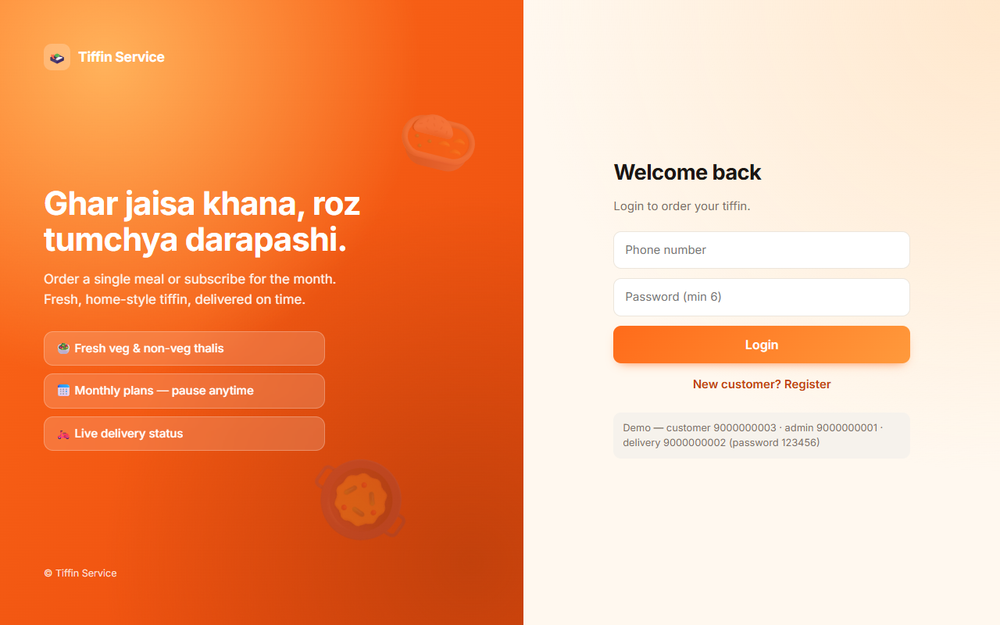
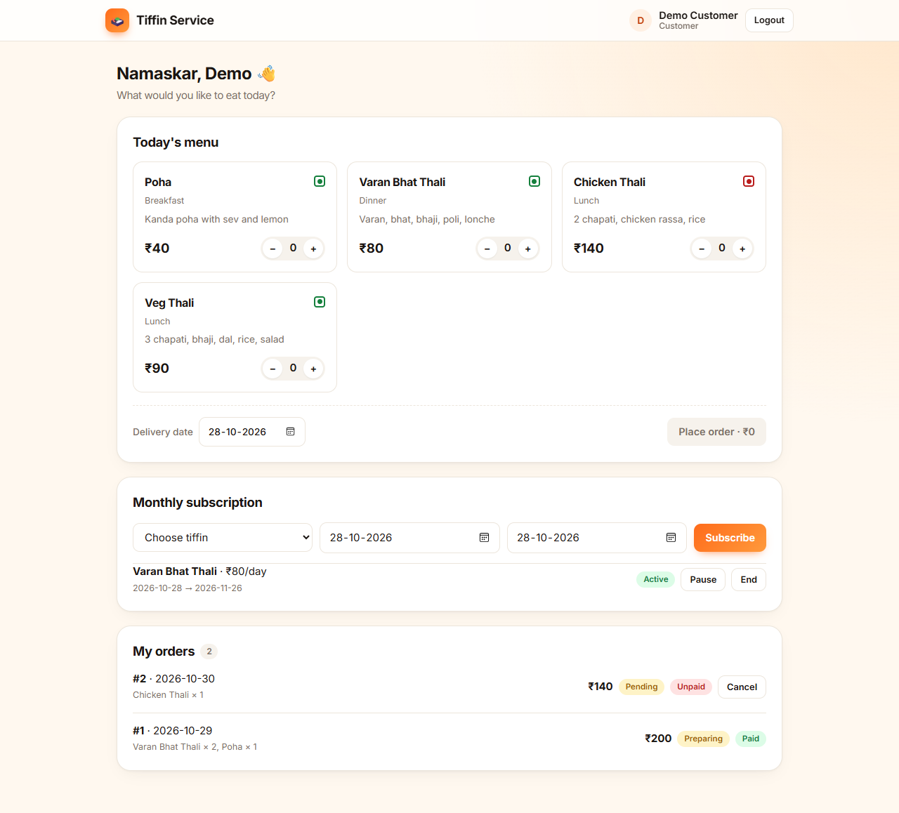
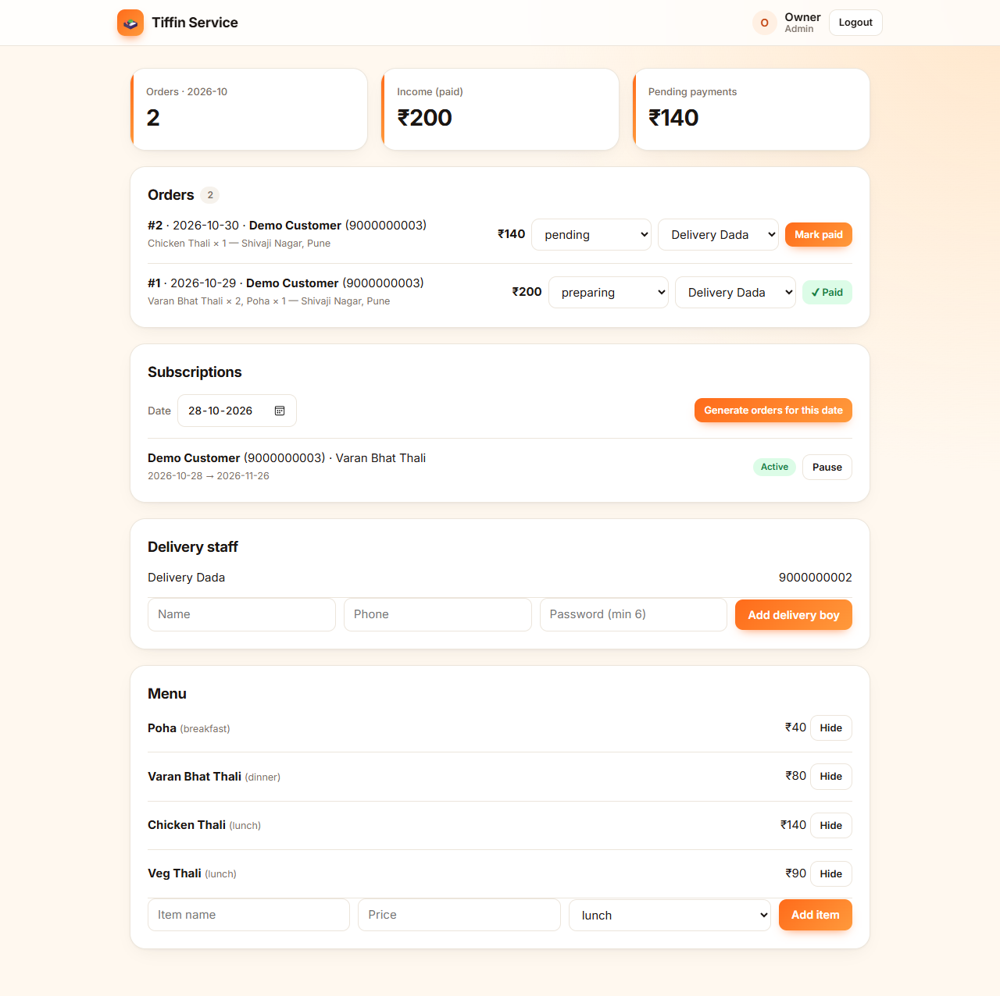
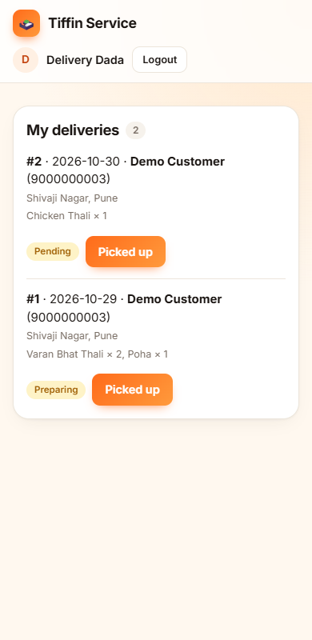

# Tiffin Service

**Live demo:** https://tiffin-service-bluo.onrender.com

Demo logins (password `123456`): customer `9000000003` · admin `9000000001` · delivery `9000000002`

> Hosted on a free plan: the first load can take ~30–60 s while the server wakes up, and demo data resets on restart.

Node/Express + SQLite backend, React (Vite) frontend. Roles: customer, admin (owner), delivery.

## Screenshots

| Login | Customer: menu, subscription, orders |
| --- | --- |
|  |  |

| Admin (owner) | Delivery (mobile) |
| --- | --- |
|  |  |

## Run

```bash
cd backend
npm install
npm run seed     # demo users + menu (password 123456)
npm start        # http://localhost:5000

cd frontend
npm install
npm run dev      # http://localhost:5173 (proxies /api to :5000)
```

Demo logins (password `123456`): admin `9000000001`, delivery `9000000002`, customer `9000000003`.

Set `JWT_SECRET` in production. Tests: `cd backend && npm test`.

## Features

- Customer: register/login, browse menu, place order for a date, cancel pending order, monthly subscription (pause/resume/end)
- Admin: orders (status, assign delivery, mark paid), menu add/hide/unhide, subscriptions, "Generate orders for date" (creates a day's orders from active subscriptions, no duplicates), add delivery staff, monthly report
- Delivery: see assigned orders, mark picked up / delivered

## Deploy (free, Render)

1. Push this folder to a GitHub repo.
2. render.com → New → Blueprint → select the repo (`render.yaml` is picked up automatically).
3. Open the URL Render gives you. One server serves both API and website.

Free plan caveats: the app sleeps after ~15 min idle (first load is slow) and the SQLite file resets on restart; `AUTO_SEED=1` refills the demo users/menu each start. For real use, take a VPS or a paid plan with a persistent disk.
